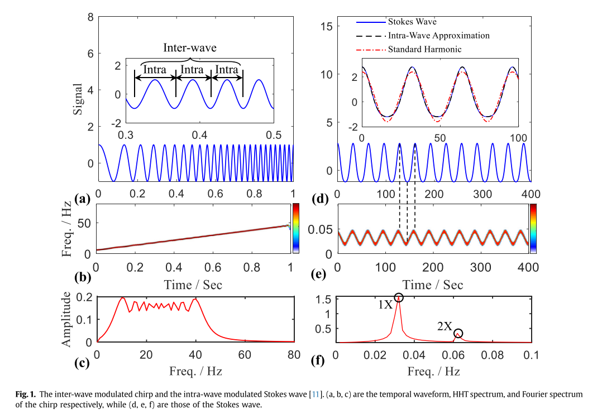
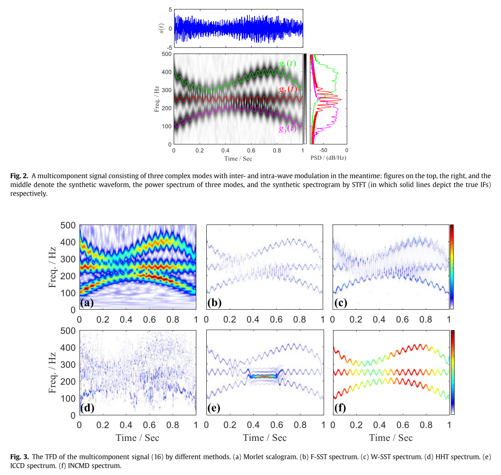
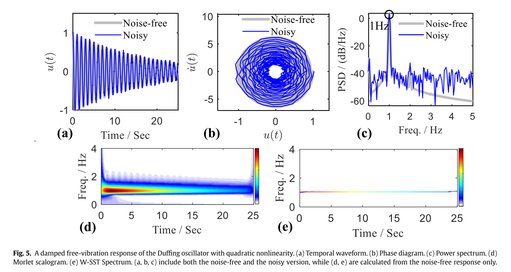
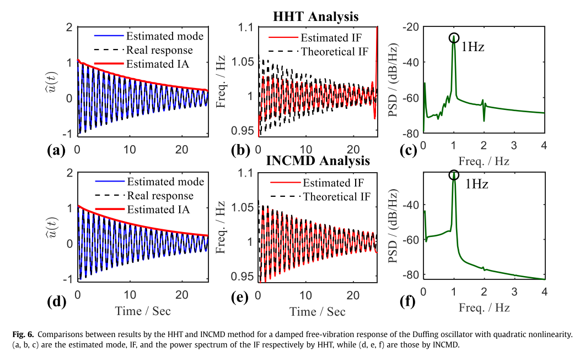
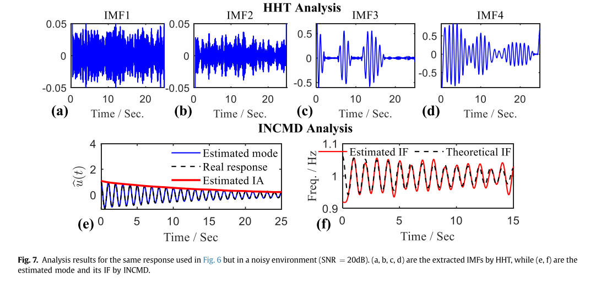
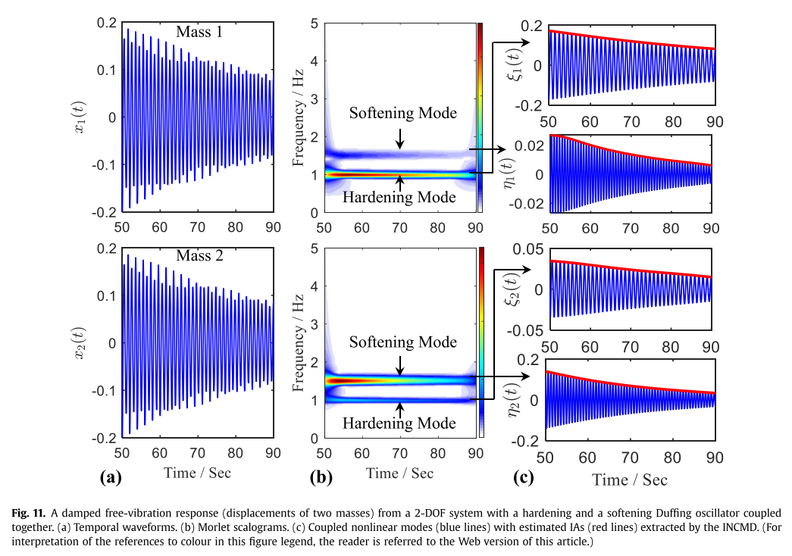

# [Signal Decomposition]Iterative Nonlinear Chirp Mode Decomposition: A Hilbert-Huang Transform Approach to Capture Intra-Modulation in Nonlinear Response Waves[with Python Code]

Introduction: Understanding the underlying physical processes behind nonlinear phenomena has always been a key issue in nonlinear dynamics research. It is often necessary to solve corresponding inverse problems to gain new insights into certain nonlinear effects. In this sense, signal processing plays an important role, as it can be used for system identification, a well-known inverse problem. There exists a duality between the forward and backward problems: The classical Poincaré perturbation method uses form power series to quantify small deviations from linear systems to nonlinear ones, which are related to harmonic distortion in time waves, one of the most clear nonlinear indicators [2]; Fourier analysis can also reveal higher harmonics and/or subharmonics, another well-known nonlinear indicator that has already been used in many practical engineering problems [3]. The basic idea of this tool is consistent with that of harmonic balance (HB), a frequency domain nonlinear system steady-state calculation method [4]. The above two types of duality capture the fundamental characteristics of nonlinear responses [1].
In the context of time-frequency analysis (TFA), the use of joint domain responses is described through the application of Temporal Frequency Analysis (TFA) techniques [5]. In this scenario, common TFA methods such as Short-Time Fourier Transform (STFT) and Wavelet Transform (WT) can be utilized to track some time-varying features, including the skeleton curve [6], instantaneous mode parameters [7], and resonance transitions [8]. It is noteworthy that the aforementioned nonlinear features are slow dynamics, which give rise to systems with slowly varying amplitudes and phases [10]. This can also be obtained analytically through average methods, Krylov-Bogoliubov-Mitropolsky (KBM) methods, or multiscale analysis [4]. Contrarily, Huang et al. (1996) [11] observed a class of rapid dynamics known as wave-in-wave modulation in analyzing classical nonlinear systems (including Duffing, Lorenz, and R ssler systems) using the Hilbert-Huang Transform (HHT) method. They first observed rapid oscillations in the instantaneous frequency (IF) and/or amplitude (IA) within the time-frequency-energy domain in the wavelet domain. As Huang pointed out [11], wave-in-wave modulation captures the inherent nonlinearity associated with harmonic distortion, rather than explaining the dispersion propagation externally displayed in the wavelet series, which should be considered as inter-wave modulation. Wave-in-wave modulation should have physical significance and provide more detailed information than modern topological tools. However, these features are lost in Fourier analysis and vaguely described in wavelet analysis [11].
Although there is no strict analysis that directly leads to this rapid dynamic behavior, it has been proven that wave-induced modulation originates from specific approximations of the classical perturbations [12], and Bessel functions describe the quantitative relationship between the modulation characteristics and harmonic distortion [1]. Following Huang's research, researchers have observed similar phenomena in many practical nonlinear systems, such as rotor systems with friction [13] or crack faults [14], non-stationary power systems [15], marine systems [16], and even human biological systems [17, 18]: internal wave modulation arises along the nonlinearity, becoming a new tool for nonlinear detection and identification.
However, the empirical nature of HHT methods prohibits new insights into this nonlinear phenomenon. HHT employs a comprehensive framework that combines adaptive signal decomposition [19] and high-resolution time-frequency representations, utilizing EMD and Hilbert transform respectively. The special elements contained in EMD make it difficult to perform mathematical analysis. Therefore, the so-called intrinsic mode functions (IMF) extracted are often physically meaningless, especially when subject to noise perturbations. Despite this, the framework has led to numerous HHT-class methods with a solid analytical foundation, among which the Synchronous Squeezing Transform (SST) proposed by Daubechies et al. [20] is a notable attempt. SST can be seen as a reassigned STFT/WT, sharpening the approximation harmonic patterns in the spectral/scale plots, but this approach cannot handle waveforms with rapid oscillations, rather than slow-varying amplitudes and frequencies. The latter is a prerequisite for the SST tools [21]. Several other works have been completed to only extract modes without performing TFA, such as the Empirical Wavelet Transform (EWT) [22] and Variational Mode Decomposition (VMD) [23]. They are limited to narrowband mode decompositions, thus not suitable for waveforms with broadband spectrum. Recently, a method based on VMD, called Variational Nonlinear Linear Frequency Modulation Mode Decomposition (VNCMD) [24], has been specifically designed for broadband multicomponent signal analysis. VNCMD follows the basic idea of VMD, but uses a data-driven demodulation operator to demodulate each mode before estimating its bandwidth, allowing for high precision extraction of modulation features [13]. However, the initialization of VNCMD requires given mode numbers and initial IF guesses for each mode, limiting its practical application.
This paper combines the ideas of HHT and VNCMD to eliminate the shortcomings of both original methods. This construction leads to a descendant of VNCMD, known as iterative nonlinear chirp mode decomposition (INCMD). INCMD uses a modified VNCMD optimizer to extract signal modes in a recursive manner (just like EMD [11] does), and Ljung-Box Q test results [25] are used as the decomposition termination criterion. Based on the spectral characteristics of waveform modulated signals [13], we obtain the peak frequency in the power spectrum density (PSD) of the current signal as a constant initial intermediate frequency, thus eliminating the need for additional intermediate frequency guessing. Case studies show that this method significantly outperforms similar technologies. Using INCMD, high-precision and strong noise robustness can be achieved in capturing waveform modulation. The modulation features extracted by INCMD not only can identify real nonlinear single-degree-of-freedom and multi-degree-of-freedom systems but also can identify simulated nonlinear single-degree-of-freedom and multi-degree-of-freedom systems. Most importantly, INCMD has a solid analytical foundation.
Conclusion: This paper primarily introduces a high-precision, noise-robust signal processing method, known as INCMD (Intrinsic Nonlinear Modulation Decomposition), which captures nonlinear responses within wavelets. Within the framework of INCMD, the joint optimization scheme used in HHT (Hierarchical Time-Scale Modeling) is replaced by the recursive process employed in VNCMD. As a result, this new method becomes more adaptable without losing its rigorous mathematical foundation. Additionally, we obtain prior information about the signal's mid-frequency content through power spectral estimation and control the decomposition termination through the results of the Ljung-Box Q test. Both strategies are highly effective and almost do not increase computational costs. Through a challenging numerical example, it has been demonstrated that our method outperforms state-of-the-art national tools such as SST, VMD, and ICCD. Based on the extracted wavelet modulation features, INCMD aids in accurately identifying nonlinear S-DOF and M-DOF systems, both simulated and real. Some noteworthy conclusions are summarized as follows:
(1) In S-DOF nonlinear systems with inter-wavelet and intra-wavelet modulation that can be separated using INCMD, the estimated results are well aligned with theoretical values derived from perturbation analysis, even in noisy environments.
(2) INCMD decomposes the response of multi-degree-of-freedom systems into physically interpretable nonlinear modes [44], where dominant modes exhibit clear wavelet modulation, while minor modes (induced by coupling effects) are virtually absent. Mode-space transformation [43] can be utilized to recover the initial spatial subsystem from the obtained modes.
(3) With INCMD, the responses of healthy beams and cracked beams can be distinguished, as the former is a standard harmonic process, while the latter shows wavelet modulation. An effective control equation can be determined using the analysis results from INCMD. INCMD also captures hidden wavelet modulation patterns in sinusoidal signals severely contaminated by noise, which is quite interesting.

## Images

<!-- PAYMENT_BLOCK -->

## Get this dataset

- Payment link (Stripe): [Buy now](https://buy.stripe.com/3cs8yP7sY87d0vu9AB)
- Payment QR code: 

<!-- /PAYMENT_BLOCK -->
